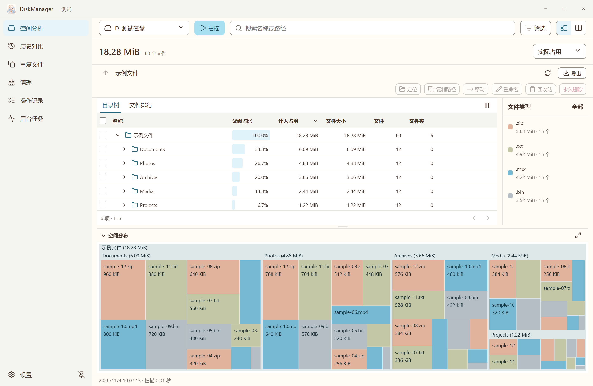

<h1 align="center">DiskManager</h1>

English | <a href="./README.zh-CN.md">简体中文</a>

Find large files, compare disk usage over time and review files before cleanup on Windows.

[Download for Windows](https://github.com/icelemon233/DiskManager/releases/latest) · [Build from source](./docs/development.md)

Windows 11 x64 is the validated target. The interface is in Simplified Chinese.

<picture>
  <source media="(prefers-color-scheme: dark)" srcset="./docs/readme/overview-dark.png">
  
</picture>

*Synthetic test files.*

## Disk analysis

- Explore a directory table and treemap, sorted by allocated space or file size.
- Compare saved scans down to individual file changes.
- Verify duplicate content across selected locations and choose copies to retain.
- Preview cache cleanup, recycling, deletion, moves and renames before confirming.
- Export CSV, reopenable scan snapshots and treemap images.

## Get started

1. Install and open **DiskManager**.
2. In **空间分析** (Disk analysis), select one local or external drive and click **扫描** (Scan).
3. Browse the results, compare a saved scan or select files to review an operation plan.

Complete scans are saved automatically. Results remain usable while history saves in the background, and normal exit waits for pending saves.

## Permissions and file operations

At startup, Windows asks you to authorize a read-only helper for fast NTFS scanning. If you decline, directory scanning remains available. **重新授权** (Authorize again) lets you retry. Other filesystems use directory traversal. The Windows package is unsigned.

File operations require confirmation and recheck file identity before execution. System locations are protected from modification. Online-only cloud files are skipped during content verification unless you choose to download them. Files in the Recycle Bin continue to occupy space until the bin is emptied.

See the [usage guide (Chinese)](./docs/usage.md) for scanning, duplicate checks, cleanup and history. Third-party licenses are listed in [third-party notices](./THIRD_PARTY_NOTICES.txt).
