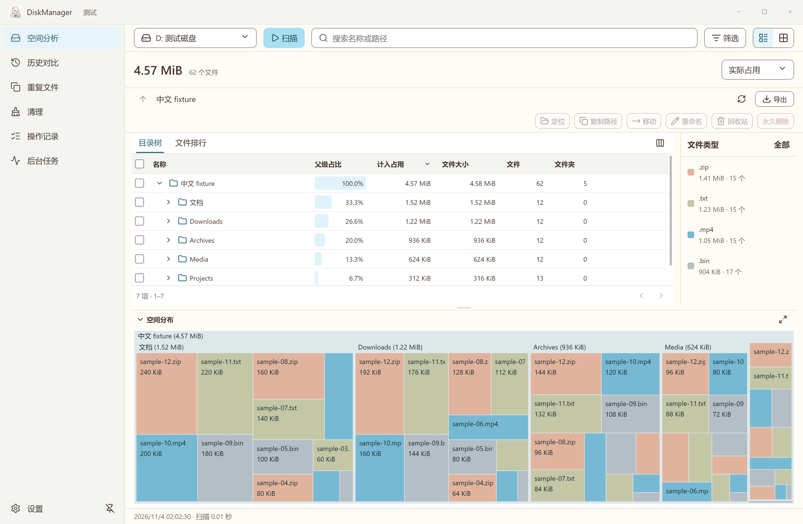

# DiskManager

[English](./README.md) | 简体中文

DiskManager 是用于查找大文件、比较空间变化和整理文件的 Windows 桌面应用，属于 Cinna 应用系列。软件界面使用简体中文。

## 查看磁盘占用

- 选择盘符，每次扫描一个本地磁盘或外接盘。启动时授权只读 MFT 扫描进程，供本次运行期间的 NTFS 整盘扫描复用，其他文件系统采用目录遍历。
- 随时切换目录表格与树图布局。按实际占用或文件大小排序，查看类型统计并筛选文件排行。
- 自动保存完整扫描，比较具体文件的新增、删除和变化。历史记录支持自动轮换、容量上限和固定保留。
- 跨位置校验重复内容，根据目录优先级建议保留项。
- 预览 Windows、浏览器和开发工具缓存清单，也可保存自定义整理规则。回收、永久删除、移动和重命名经过确认后执行，并重新核对文件身份。
- 导出 CSV、可重新打开的完整快照和树图 PNG。

分析结果就绪后即可浏览，历史在后台继续保存。界面显示保存状态，正常退出时等待保存完成。



## 开始使用

从 [GitHub Releases](https://github.com/icelemon233/DiskManager/releases/latest) 下载 Windows x64 安装包。已验证的平台为 Windows 11 x64。

运行 `DiskManager-1.0.8-windows-x64-setup.exe`，在“空间分析”中选择盘符并点击“扫描”。应用启动时请求 Windows 管理员授权，快扫进程持续运行至应用退出。取消授权后可继续普通扫描，也可通过“重新授权”重试。

当前安装包未签名。文件操作对系统关键位置启用只读保护。在线云文件默认跳过内容校验，主动选择下载后才读取内容。移入回收站的文件仍占空间，清空回收站后才释放。

操作流程见[使用说明](docs/usage.md)，构建与验证信息见[开发说明](docs/development.md)。

## 从源码运行

在 Windows 上安装 Node.js 24、pnpm 11 和 .NET 10 SDK。

```powershell
pnpm install --frozen-lockfile
pnpm native
pnpm build
pnpm desktop
```

第三方声明收录于 [THIRD_PARTY_NOTICES.txt](THIRD_PARTY_NOTICES.txt)。
